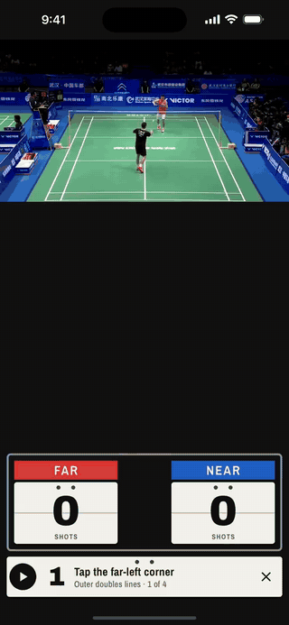
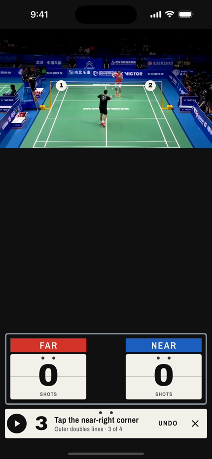
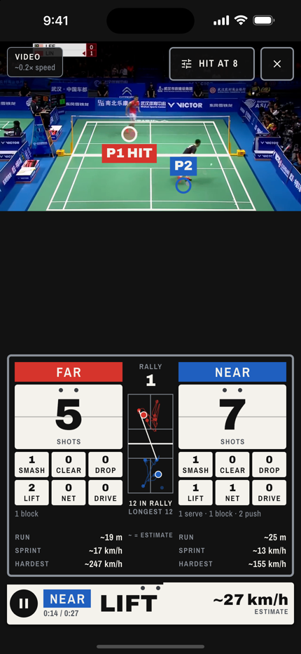
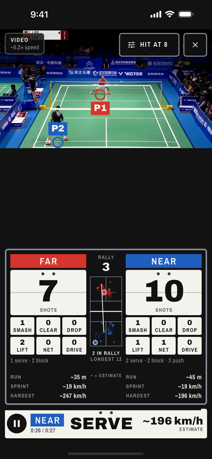

# Shuttle Live

Live badminton singles analysis on a phone. Put the phone on a tripod behind one baseline,
tap the four court corners, and play. Shuttle Live counts shots, names them, maps where each
player stood, and estimates distance run, sprint speed and shuttle speed. Everything runs on
the phone: no desktop GPU, no upload.

<p align="center"></p>

<sub>[Full-quality video](docs/media/demo.mp4). A 27-second excerpt of Lin Dan v Lee Chong Wei, analysed in video mode in the iOS
Simulator. The simulator analyses at about 0.2× speed, so the recording is sped up to real time.</sub>

| Set the court | Mid-rally | End of the clip |
|---|---|---|
|  |  |  |

## What it shows

- **Shots** for each player (far in red, near in blue), with shot types: serve, smash, clear,
  drop, lift, net, drive, block, push.
- **Rally** length and the longest rally so far.
- **Court map** with each player's position and recent path, and where the last shots were
  hit from.
- **Run, sprint and hardest shot**: distance covered, top running speed and the fastest
  shuttle estimate.

Numbers marked `~` are estimates. Shuttle speed comes from the time between a hit and its
reply, corrected for air drag, so it is a rough figure, not a radar reading.

## How it works

- One on-device pose model ([Ultralytics YOLO26n-pose](https://docs.ultralytics.com/)) finds
  both players in each frame. Tapping the four outer court corners maps the picture to court
  metres.
- **Live camera:** a hit is a fast wrist swing, measured against the player's own torso so
  running about doesn't count.
- **Video mode** (open a saved clip, for example a TV match): hits are timed by the racket's
  sound in the clip's audio (2–8 kHz), and the pose decides who hit. Frames are shown only
  once they have been analysed, so playback may run slower than real time. Camera cuts and
  replays are detected and not counted.
- A rally ends after 3 s with no hit. Each shot is named once its reply arrives or the rally
  ends.

## Status

A prototype, not yet tried on a real court.

- iPhone: the live camera and the first video mode ran on an iPhone 15 Plus; the
  sound-timed video mode has so far run only in the iOS Simulator.
- Android: builds, but has not been run on a real phone yet.

## Build

Needs Flutter 3.38 (Dart 3.10), Xcode for iOS (iOS 15+), and the Android SDK for Android
(API 24+).

```sh
flutter pub get
flutter run            # pick an iPhone or Android phone
flutter test           # unit and widget tests
```

The plugin downloads the pose model the first time it is used. It is a patched copy of
[ultralytics_yolo](https://github.com/ultralytics/yolo-flutter-app) 0.7.1 in
`third_party/ultralytics_yolo` (iOS only: 1× lens, 4:3 frames at 30 fps).

## Licence

[AGPL-3.0](LICENSE), the same licence as the Ultralytics plugin and models it uses.
